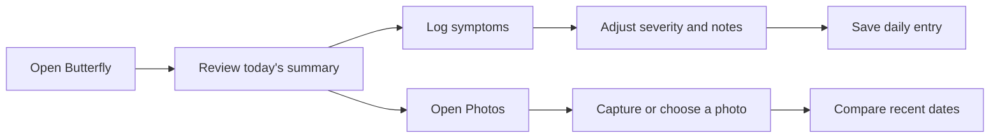

# Butterfly

Butterfly is a personal health companion for tracking symptoms, reviewing health trends, and comparing progress photos over time. It is designed to help people notice patterns in conditions such as thyroid-related symptoms and keep a simple record they can revisit.

## Mini demo

### Walkthrough

1. Launch the `App` target in Xcode.
2. Open symptom tracking and select the symptoms you want to record.
3. Adjust each severity, add an optional note, and save the entry.
4. Open photo comparison, choose `Eye Disease` or `Goiter`, and capture a photo or select one from the photo library.
5. Browse recent dates and compare a selected photo with today's photo.

## Run locally

Open `App.xcodeproj` in Xcode, select an iOS Simulator or connected device running iOS 18.5+, and run the `App` scheme.

## Current prototype scope

- Symptom and photo data are stored locally on the device.
- Sign in with Apple scaffolding is present but is not yet connected to the main app flow.
- Cloud photo upload is not implemented; the current R2 path is a placeholder.
